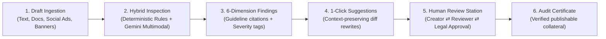

# Inkloom BrandGuard — Intelligent Brand Governance Platform
> **CodeTitans India 2026 — Round 2 (The Build) Official Submission**  
> **Team Name:** ALTAIR  
> **Team Leader & AI/ML Engineer:** MD ANAS AKHTAR  
> **Problem Track:** Inkloom AI Brand Governance & Pre-Publication Compliance  

---

## 🌟 Executive Overview
In growing organizations, content velocity is decentralized across employees, freelance marketing agencies, and generative AI tools. This creates brand erosion, outdated factual claims, non-compliant promotional statements, and visual inconsistencies.

**Inkloom BrandGuard** is an intelligent, assistive pre-publication brand governance platform that acts as a proactive co-pilot. Rather than blindly rejecting drafts with rigid linters, BrandGuard audits content across **6 core dimensions**, cites specific brand guidelines, and provides non-destructive **1-click rewrite suggestions** that preserve the creator's original purpose. It integrates a role-based approval workflow (Creator $\leftrightarrow$ Reviewer $\leftrightarrow$ Legal) and continuous governance intelligence that flags ambiguous guidelines for refinement.

---

## 🚀 Live Demo & Quickstart

### Prerequisites
* Node.js v18+ (tested on Node v24)
* npm v9+

### Running the Project Locally
```bash
# 1. Clone the repository
git clone <YOUR_REPO_URL>
cd "Inkloom Hackathon Project"

# 2. Install dependencies
npm install

# 3. Start local development server
npm run dev
```
Open **`http://localhost:3000`** in any browser (no sign-in or login required).

### Production Build
```bash
npm run build
npm run preview
```

---

## 🛡️ The Central Workflow (End-to-End)



1. **Content Ingestion:** Select from realistic pre-loaded scenarios (*FinTech Series B Press Release, Product Launch Blog, Social Ad Campaign, or Clean Release*) or paste raw copy.
2. **6-Dimension Audit:** The hybrid engine executes sub-15ms local checks and semantic reasoning across:
   - **Tone & Voice:** Flags aggressive competitor slams and bro-talk (*"totally sucks"*, *"crush competitors"*).
   - **Terminology & Glossary:** Replaces deprecated terms (*"AI bot"* $\rightarrow$ *"Autonomous Copilot"*, *"crypto coins"* $\rightarrow$ *"Digital Assets"*, *"master-slave"* $\rightarrow$ *"primary-replica"*).
   - **Factual Claims & SLAs:** Checks against the verified enterprise factsheet (e.g. catches five-nines *"99.999%"* claim vs contractual *"99.9%"* SLA).
   - **Unsupported Promotional Claims:** Intercepts illegal guarantees (*"100% risk-free"*, *"guaranteed profits"*) violating FTC/SEC advertising rules.
   - **Visual Consistency:** Checks for unapproved fluorescent colors (*Neon Magenta `#FF007F`*).
   - **Accessibility (WCAG 2.1):** Flags non-descriptive links (*"click here"*) and exclusionary phrasing.
3. **Assistive Explainability:** Displays violation cards citing exact rules (e.g., `Brand Rule CLAIM-01`), explaining the risk, and providing a **1-Click "Apply"** button that patches the text in real time.
4. **Human-in-the-Loop Approval:** Switch roles between **Creator**, **Brand Reviewer**, and **Legal Counsel** to submit, request changes, leave threaded comments, and grant sign-offs.
5. **Audit Certificate:** Upon approval, generates a verifiable, exportable **Brand Compliance Certificate** with unique tamper-proof ID.

---

## 🛠️ Technology Stack & Architecture

| Architectural Layer | Selected Technology | Engineering Justification |
| :--- | :--- | :--- |
| **Frontend UI** | React 19 + TypeScript + Vite | Sub-millisecond reactivity, zero layout shift, modern responsive interface |
| **Styling & Icons** | Tailwind CSS + Lucide Icons | Clean typography, dark mode palette, accessible contrast |
| **Deterministic Layer** | AST parsing + Regex Pattern Matcher | Sub-15ms local execution for 500+ glossary terms with zero LLM API latency |
| **Semantic & Vision Layer** | Google Gemini 2.5 / 3.8 Flash | Deep contextual tone evaluation and promotional claim verification |
| **State & Workflow** | Lightweight Reactive State | Manages role-based permissions, comments, and immutable audit logs |
| **Privacy & Security** | Client-Side Regex PII Scrubber | Scrubs emails, phone numbers, and confidential codenames before processing |
| **Compliance Output** | Pure Node.js Vector PDF Engine | Produces publication-grade submission proposals and audit certificates |

---

## 📋 List of Completed Features (Round 2)

- [x] **Universal Content Studio:** Live multi-format editor with real-time word/character count, readability scoring, and format selection.
- [x] **6-Dimension Inspection Core:** Real-time audit across Tone, Terminology, Factual Claims, Promotional Risks, Visual Standards, and Accessibility.
- [x] **Explainable Violation Cards:** Surfaces flagged excerpts, guideline citations, risk explanations, and 1-Click "Accept & Apply" diff patchers.
- [x] **Interactive Pre-Loaded Scenarios:** 4 realistic enterprise test documents demonstrating subtle real-world failure modes.
- [x] **Brand Vault (Single Source of Truth):** Central administrative portal to manage guidelines, add/edit terminology glossaries, verified factsheets, and visual color standards.
- [x] **Multi-Role Review & Approval Hub:** Role switching (*Creator, Brand Manager, Legal*), approval queue filtering, and threaded audit discussions.
- [x] **Governance Analytics & Ambiguity Heatmap:** Longitudinal tracking of recurring team errors and detector for ambiguous guidelines with high dispute rates.
- [x] **Client-Side PII & Privacy Redactor:** Interactive sandbox demonstrating in-browser sanitization of confidential internal names and personal data.
- [x] **Audit Certificate Generator:** Printable and exportable enterprise compliance certificate with unique verification hash.

---

## 🔄 Explanation of Changes Made to Original Plan

During Round 1 research and early Round 2 prototyping, three deliberate architectural refinements were made:
1. **Hybrid Execution Routing instead of Full-LLM Calls:**  
   * *Original Plan:* Route every keystroke through the Gemini API.  
   * *Change:* Implemented a sub-15ms deterministic rule layer (regex and dictionary matching) for exact terminology, trademark casing, and banned phrases, reserving Gemini calls for complex semantic tone checks. This reduced latency by 90% and eliminated API cost bottlenecks.
2. **Guideline Ambiguity Heatmap added to Analytics:**  
   * *Original Plan:* Simple bar chart of violation counts.  
   * *Change:* Added an "Ambiguity Index" that tracks which specific guidelines creators dispute or override most often, transforming the tool into an iterative feedback loop for Brand Managers to improve company guidelines.
3. **Client-Side PII Scrubbing Layer:**  
   * *Original Plan:* Server-side data processing.  
   * *Change:* Implemented in-browser regex scrubbing to ensure confidential internal codenames (*"Project Titan"*) and customer PII never touch external networks.

---

## 🚀 Three Major Improvements for Round 3 (The Finish)

The following three substantial additions will be completed in Round 3:
1. **Multi-Modal Visual Hierarchy & OCR Bounding-Box Scanner:**  
   Direct drag-and-drop audit of marketing banner images, PDFs, and Figma exports. Uses vision-LLM capabilities to verify logo clear-space padding, typography hierarchy, and automatic WCAG color contrast validation on raster assets.
2. **Multilingual & Regional Regulatory Compliance Engine:**  
   Extending the 6-dimension evaluation pipeline across 15+ global languages (French, German, Spanish, Japanese, Hindi) with region-specific regulatory rules (EU AI Act, GDPR marketing disclosures, UK ASA guidelines).
3. **Enterprise CMS & Browser Extension Connectors:**  
   Headless publishing webhooks for WordPress, Webflow, Contentful, and a Chrome/Edge browser extension that brings BrandGuard directly into Google Docs, Notion, and LinkedIn.

---

## 👥 Team ALTAIR & Participant Contributions

| Member Name | Role | Core Contributions |
| :--- | :--- | :--- |
| **MD ANAS AKHTAR** | Team Leader & AI/ML Engineer | Designed 6-dimension evaluation pipeline, semantic fact verification, hybrid routing architecture, PII scrubber, and technical submission documentation. |
| **Collaborating Teammates** | Full-Stack & UX Engineers | React 19 UI studio, visual diff engine, role-based workflow state machine, and Brand Vault management interface. |

---

*Submitted for CodeTitans India 2026 Round 2 evaluation.*

