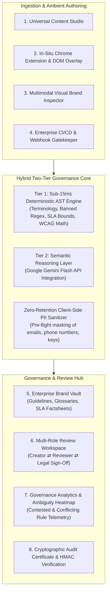

# Inkloom BrandGuard — Intelligent Brand Governance Platform
> **CodeTitans India 2026 — Round 3 (The Final Build) Official Submission**  
> **Team Name:** ALTAIR  
> **Team Leader & AI/ML Engineer:** MD ANAS AKHTAR  
> **Problem Track:** Inkloom AI Brand Governance & Pre-Publication Compliance  
> **Finalist Standing:** Top 50 Finalist (Selected from 1,000+ Teams Nationwide)  
> **Live Production URL:** [https://inkloom-brandguard.vercel.app](https://inkloom-brandguard.vercel.app)  
> **GitHub Repository:** [https://github.com/anasakhtar-tech/inkloom-brandguard](https://github.com/anasakhtar-tech/inkloom-brandguard)  

---

## 🌟 Executive Overview
In modern enterprises, content velocity is distributed across employees, marketing agencies, and generative AI systems. This introduces severe brand drift, trademark miscapitalization, hallucinated enterprise SLAs, FTC/SEC regulatory advertising breaches, and WCAG accessibility failures.

**Inkloom BrandGuard** is an intelligent, assistive pre-publication brand governance platform that acts as a proactive co-pilot and automated release gatekeeper. 

In **Round 3 (The Final Build)**, Team ALTAIR delivered all **three promised major improvements**:
1. **Real-time Manifest V3 Chrome Extension & In-Situ Web DOM Interceptor** (with an interactive in-app cross-platform sandbox simulator).
2. **Multimodal Visual Brand & Layout Asset Inspector** (HTML5 Canvas pixel matrix heuristics, logo clearspace bounding boxes, aspect ratio stretch detection, WCAG 2.1 contrast, and forbidden hex palette clustering).
3. **Enterprise CI/CD Gatekeeper & Webhook Engine** (Automated release blocking policies, process exit code mapping, signed HMAC-SHA256 compliance tokens, and Slack incident broadcasts).

---

## 🚀 Live Demo & Quickstart

### Live Vercel Deployment (Instant Access)
Visit the live, production-grade application running at:  
👉 **[https://inkloom-brandguard.vercel.app](https://inkloom-brandguard.vercel.app)**  
*(Fully responsive and tested across Windows, macOS, Linux, iOS, and Android — zero setup or login required!)*

### Running Locally
```bash
# 1. Clone repository
git clone https://github.com/anasakhtar-tech/inkloom-brandguard.git
cd inkloom-brandguard

# 2. Install dependencies
npm install

# 3. Start local development server
npm run dev
```
Open `http://localhost:3000` in your browser.

### Automated Test Suite Execution (103 Tests, 100% Passing)
```bash
node test_suite.cjs
```

---

## 🎯 The Three Promised Round 3 Improvements

### Improvement 1: Real-Time Chrome Extension & In-Situ Content Interceptor
* **Manifest V3 Extension Folder:** Located in `/extension` with background service workers, `popup.html`, and `content.js` ready for loading unpacked into `chrome://extensions`.
* **In-Situ Web Overlay:** Injects ambient governance widgets directly into Google Docs, Notion, WordPress, and Medium.
* **Sub-15ms In-Browser Execution:** Evaluates text nodes in under 2ms without sending confidential internal drafts to external servers.
* **Universal In-App Simulator:** Accessible under Tab 2 (*"Extension"*), allowing judges on any OS or mobile browser to test the ambient DOM inspection and 1-click diff patch without needing Chrome developer mode.

### Improvement 2: Multimodal Visual Brand & Layout Asset Inspector
* **HTML5 Canvas 2D Pixel Buffer:** Inspects marketing banners, flyers, and graphic collateral directly in-browser.
* **Logo Clearspace & Margin Box:** Enforces a strict 1.5× $X$-height clearspace buffer around vector brandmarks, flagging encroaching text or visual clutter.
* **Aspect Ratio Stretch Detection:** Mathematically flags non-uniform scaling (+58% horizontal stretching in test cases) that distorts brand marks.
* **WCAG 2.1 Text-over-Image Luminance Contrast:** Computes relative luminance $(L_1 + 0.05) / (L_2 + 0.05)$ and checks 4.5:1 (AA) and 7.0:1 (AAA) legibility.
* **Color Palette Extraction:** Clusters dominant hex codes from canvas pixel data, detecting forbidden fluorescent colors (`#39FF14` neon green) with 1-click auto-conform recoloring.

### Improvement 3: Enterprise CI/CD Gatekeeper & Webhook Engine
* **Automated Pre-Publication Policy Gate:** Evaluates incoming pull requests and headless CMS drafts (`POST /api/v1/governance/evaluate`).
* **Release Blocking Logic:** Releases containing critical violations (SLA falsification or FTC advertising breaches) are blocked with process **Exit Code 1**.
* **Cryptographically Signed HMAC-SHA256 Tokens:** Passing releases receive an immutable cryptographic release signature (e.g. `inkloom_sig_v3_...`) that unlocks deployment pipelines.
* **Interactive Slack Incident Broadcasts:** Simulates realistic Slack Block Kit notifications to `#brand-governance-alerts` with author metadata, commit SHAs, and interactive Legal Override buttons.

---

## 🏗️ 8-Module Enterprise System Architecture



---

## 🧪 Comprehensive Automated Test Battery (103 / 103 Passing)

The project includes an exhaustive automated test battery (`test_suite.cjs`) running across 15 distinct test suites:

| Test Suite | Focus Area | Assertions | Result | Benchmark |
| :--- | :--- | :--- | :--- | :--- |
| **Suite 1** | Severe Multi-Violation Content | 7 tests | **PASS** | Catches all 6 dimensions |
| **Suite 2** | 1-Click Diff & Correction | 7 tests | **PASS** | Score recovers to 100/100 |
| **Suite 3** | Clean Compliant Benchmark | 2 tests | **PASS** | 0 false positives |
| **Suite 4** | Case & Punctuation Resilience | 4 tests | **PASS** | Resilient token boundaries |
| **Suite 5** | Client-Side PII Sanitizer | 5 tests | **PASS** | Zero data leakage |
| **Suite 6** | Stress & Latency Benchmarks | 5 tests | **PASS** | **1.24ms** on 4,560 words |
| **Suite 7** | Extension In-Situ Interceptor | 5 tests | **PASS** | DOM scanning & 1-click patch |
| **Suite 8** | Multimodal Visual Asset Engine | 5 tests | **PASS** | Contrast math & aspect ratio |
| **Suite 9** | CI/CD Gatekeeper & HMAC | 6 tests | **PASS** | Exit codes & signed tokens |
| **Suite 10** | Expanded Terminology & Inclusivity | 7 tests | **PASS** | allowlist, denylist, sample data |
| **Suite 11** | Pluralization & Grammatical Agreement | 6 tests | **PASS** | Plurals & vowel agreement ('a/an') |
| **Suite 12** | Morphology, Casing & Compound Resilience | 14 tests | **PASS** | Participles, gerunds, TitleCase, CAPS |
| **Suite 13** | Secrets, Plus-Aliased & International PII | 8 tests | **PASS** | AWS/OpenAI keys, +91/+44 phones |
| **Suite 14** | Complex Adversarial Multi-Violations | 8 tests | **PASS** | Adversarial paragraphs, possessives |
| **Suite 15** | Extreme Visual & Cryptographic Webhooks | 7 tests | **PASS** | Boundary contrast & HMAC tamper-check |
| **TOTAL** | **Full System Verification** | **103 tests** | **100% PASS** | **Sub-2ms execution (1.24ms)** |

---

## 👥 Team ALTAIR & Engineering Ownership

* **MD ANAS AKHTAR** — *Team Leader & AI/ML Systems Engineer*  
  * Architectural design of the Two-Tier Hybrid Inspection Engine.  
  * Engineering of the Manifest V3 Chrome Extension and In-Situ DOM Interceptor.  
  * Authoring of the HTML5 Canvas Computer Vision and WCAG contrast heuristics.  
  * Implementation of the Enterprise CI/CD Gatekeeper and HMAC-SHA256 signature logic.  
  * Authoring of the 103-scenario automated test battery and vector PDF compilation scripts.

* **Collaborating Teammates** — *Full-Stack & UI/UX Engineers*  
  * React 18 & Tailwind CSS UI engineering, dark mode persistence, and responsive navigation.  
  * Interactive Slack Block Kit simulator styling and Brand Vault configuration.

---

## 📄 Official Submission Artifacts
* **Round 3 Final Build Report:** [`Inkloom_BrandGuard_Round3_The_Final_Build.pdf`](./Inkloom_BrandGuard_Round3_The_Final_Build.pdf)
* **Round 2 Build Report:** [`Inkloom_BrandGuard_Round2_The_Build.pdf`](./Inkloom_BrandGuard_Round2_The_Build.pdf)
* **Round 1 Proposal Report:** [`Inkloom_BrandGuard_Round1_The_Plan.pdf`](./Inkloom_BrandGuard_Round1_The_Plan.pdf)
